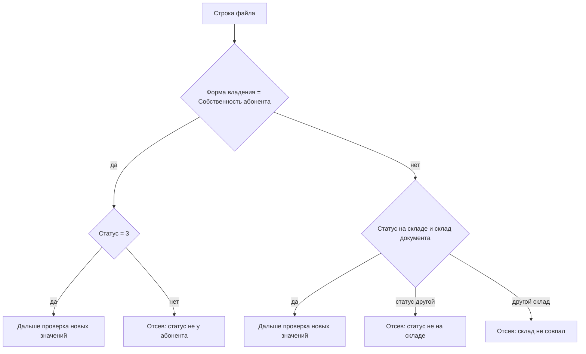

# Сценарии испытания смены серийных номеров и параметров

Текст приведён к форме «Загрузка и проверка смены серийных номеров». Файл один и тот же для абонентского и сетевого оборудования.

## Комбинации успеха и отсева

Смена формы владения на «Собственность абонента» требует статус `3` («у абонента»). Склад при этом не проверяется.

Смена идентификаторов, смена состояния и тех. состояния, а также любая другая форма владения, включая пустую, требуют статус «на складе» и размещение на складе документа. Иначе строка уходит в отсев.

Если в строке проверки переданы форма владения, состояние или тех. состояние, база не проверяет новые SN, MAC и PON: пустые новые поля, повтор в файле и занятость номера в системе не дают отсев. Текущие MAC и PON из файла не сверяются.

| Режим | Форма владения | Статус | Склад экземпляра | Новые SN, MAC, PON | Результат |
|---|---|---|---|---|---|
| Смена идентификаторов | Не передаётся | На складе | Склад документа | Есть свободное новое значение, повторов нет | Успех |
| Смена идентификаторов | Не передаётся | Не «на складе» | Склад документа | Любые | Отсев: Статус эксплуатации оборудования не соответствует значению «на складе» |
| Смена идентификаторов | Не передаётся | На складе | Другой склад | Любые | Отсев: Склад проведения корректировки не соответствует складу фактического размещения оборудования |
| Смена идентификаторов | Не передаётся | На складе | Склад документа | Все новые поля пустые | Отсев: Не задано ни одного нового значения |
| Смена идентификаторов | Не передаётся | На складе | Склад документа | Серийный номер не найден | Отсев: Оборудование не найдено |
| Смена идентификаторов | Не передаётся | На складе | Склад документа | Новый SN или MAC занят | Отсев: Новый серийный номер уже есть в системе / Новый MAC уже есть в системе |
| Смена идентификаторов | Не передаётся | На складе | Склад документа | Повтор в файле | Отсев: Повторяющийся SN_текущий / SN_новый / MAC_новый |
| Смена идентификаторов | Не передаётся | На складе | Склад документа | Два экземпляра с одним серийным номером | Отсев: Найдено больше одного экземпляра |
| Смена формы владения | Пусто или не «Собственность абонента» | На складе | Склад документа | Не проверяются | Успех |
| Смена формы владения | Пусто или не «Собственность абонента» | Не «на складе» | Любой | Не проверяются | Отсев: Статус эксплуатации оборудования не соответствует значению «на складе» |
| Смена формы владения | Пусто или не «Собственность абонента» | На складе | Другой склад | Не проверяются | Отсев: Склад проведения корректировки не соответствует складу фактического размещения оборудования |
| Смена формы владения | Собственность абонента | `3`, у абонента | Любой | Не проверяются | Успех |
| Смена формы владения | Собственность абонента | Не `3` | Любой | Не проверяются | Отсев: Статус эксплуатации оборудования не соответствует значению «у абонента» |
| Смена состояния и тех. состояния | Не передаётся | На складе | Склад документа | Не проверяются | Успех |
| Смена состояния и тех. состояния | Не передаётся | Не «на складе» | Любой | Не проверяются | Отсев: Статус эксплуатации оборудования не соответствует значению «на складе» |
| Смена состояния и тех. состояния | Не передаётся | На складе | Другой склад | Не проверяются | Отсев: Склад проведения корректировки не соответствует складу фактического размещения оборудования |

## 4.2.2. Подготовительные мероприятия для сценариев с успешным результатом

На тестовых складах завести экземпляры из таблицы 1. Документ корректировки создаётся на складе, где лежит успешный экземпляр. Для смены идентификаторов, смены состояния и тех. состояния и для формы владения, отличной от «Собственность абонента», экземпляр должен быть в статусе «на складе» и на складе этого документа.

Сформировать два файла CSV в кодировке Windows-1251, разделитель «;», первая строка — заголовок:

`SN_текущий;SN_новый;MAC_новый;PON_новый`

Пустое новое поле означает, что этот атрибут не меняется. `SN_текущий` обязателен и является ключом поиска экземпляра. Текущие MAC и PON в файл не входят. Строка, в которой пусты все четыре колонки, включая `;;;`, при чтении отбрасывается и в проверку не отправляется. Допустимы также xls и xlsx: перед разбором они преобразуются в CSV.

Скачиваемый шаблон зависит от вкладки. «Смена идентификаторов» сохраняет файл `Шаблон смены идентификаторов.csv` с четырьмя колонками. «Смена формы владения» и «Смена параметров» сохраняют `Шаблон серийного номера.csv` с одной колонкой `SN_текущий`.

### Таблица 1. Успешный результат

| № | Экземпляр | Что записано в файле | Режим на форме | Файл |
|---|---|---|---|---|
| 1 | Статус «на складе», размещён на складе документа. Уникальный серийный номер, MAC и PON. Новые серийный номер и MAC в системе свободны | Заполнены `SN_новый`, `MAC_новый`, `PON_новый` | Смена идентификаторов | Файл 1 |
| 2 | Статус «на складе», размещён на складе документа. Другой экземпляр с уникальным серийным номером | Заполнен только `SN_новый`. `MAC_новый` и `PON_новый` пустые | Смена идентификаторов | Файл 1 |
| 3 | Статус «на складе», размещён на складе документа | Новые SN, MAC и PON пустые | Смена формы владения. «Собственность компании» либо пустая | Файл 2 |
| 4 | Экземпляр в статусе `exploit_status_id = 3`, «у абонента» | Новые SN, MAC и PON пустые | Смена формы владения. «Собственность абонента» | Файл 2 |
| 5 | Статус «на складе», размещён на складе документа | Новые SN, MAC и PON пустые | Смена состояния и тех. состояния | Файл 2 |

## 4.2.3. Подготовительные мероприятия для сценариев с неуспешным результатом

Файл 3 проверяется на вкладке «Смена идентификаторов». Файл 4 проверяется на вкладке «Смена формы владения» для строк 10–12 и на вкладке «Смена параметров» для строк 13–14. Состав колонок тот же, что у файлов 1 и 2.

### Таблица 2. Неуспешный результат

| № | Условие | Текст в колонке «Результат проверки» | Файл |
|---|---|---|---|
| 1 | `SN_текущий` в системе отсутствует | Оборудование не найдено | Файл 3 |
| 2 | Новые SN, MAC и PON пустые | Не задано ни одного нового значения | Файл 3 |
| 3 | Две строки с одним и тем же `SN_текущий` | Повторяющийся SN_текущий | Файл 3 |
| 4 | Две строки с одним и тем же `SN_новый`, и он отличается от текущего | Повторяющийся SN_новый | Файл 3 |
| 5 | `SN_новый` уже записан на другом экземпляре, который не отдаёт этот номер в этом же файле | Новый серийный номер уже есть в системе | Файл 3 |
| 6 | `MAC_новый` уже записан на другом экземпляре | Новый MAC уже есть в системе | Файл 3 |
| 7 | Два действующих экземпляра с одним серийным номером | Найдено больше одного экземпляра | Файл 3 |
| 8 | Смена идентификаторов, статус не «на складе», склад совпадает со складом документа | Статус эксплуатации оборудования не соответствует значению «на складе» | Файл 3 |
| 9 | Смена идентификаторов, статус «на складе», экземпляр лежит на другом складе | Склад проведения корректировки не соответствует складу фактического размещения оборудования | Файл 3 |
| 10 | Смена формы владения, форма владения не «Собственность абонента», статус не «на складе» | Статус эксплуатации оборудования не соответствует значению «на складе» | Файл 4 |
| 11 | Смена формы владения, форма владения не «Собственность абонента», экземпляр на другом складе | Склад проведения корректировки не соответствует складу фактического размещения оборудования | Файл 4 |
| 12 | Смена формы владения, форма владения «Собственность абонента», `exploit_status_id` не равен 3 | Статус эксплуатации оборудования не соответствует значению «у абонента» | Файл 4 |
| 13 | Смена состояния и тех. состояния, статус не «на складе» | Статус эксплуатации оборудования не соответствует значению «на складе» | Файл 4 |
| 14 | Смена состояния и тех. состояния, экземпляр на другом складе | Склад проведения корректировки не соответствует складу фактического размещения оборудования | Файл 4 |

## 4.3. Сценарии тестирования

### Сценарий 4.3.1. Доступ к загрузке смены серийных номеров

Цель: привилегия `StoreDeviceView.AddIdentifierChange` открывает на форме оборудования документа кнопку «Смена серийных номеров из файла».

Подготовка: войти в интерфейс склада.

#### Таблица 3

| № | Интерфейс | Действия | Результат |
|---|---|---|---|
| 1 | Склад → Справочники → Роли и привилегии | Для роли «Администрирование» добавить привилегию с кодом `StoreDeviceView.AddIdentifierChange`. Перезапустить приложение «Склад». | Привилегия назначена роли. |
| 2 | Документ склада, на котором доступна команда «Добавить из файла» | 1. Открыть табличную часть оборудования документа. 2. Убедиться, что рядом с «Добавить из файла» активна кнопка «Смена серийных номеров из файла». 3. Открыть её. 4. На форме «Загрузка и проверка смены серийных номеров» переключить три вкладки: «Смена идентификаторов», «Смена формы владения», «Смена параметров». 5. При открытии формы активна вкладка «Смена идентификаторов». Загрузка файла — кнопка в верхней панели, шаблон — кнопка на первой вкладке. 6. На второй вкладке список формы владения недоступен (`IsEnabled="False"`) и стоит на втором элементе (`SelectedIndex="1"`). Под ним справка про филиал, статус «у абонента», условие «Аренда» и форму «Собственность компании». 7. На третьей видны состояние и тех. состояние. 8. С первой вкладки скачать шаблон и сверить заголовок: `SN_текущий;SN_новый;MAC_новый;PON_новый`. Со второй и третьей вкладок скачать шаблон и сверить заголовок: `SN_текущий`. | Кнопка доступна только при привилегии `StoreDeviceView.AddIdentifierChange` и при том же условии видимости, что и «Добавить из файла». Отдельного пункта «Изменение параметров оборудования» в списке операций документа нет. Набор редактируемых атрибутов задаётся вкладкой формы загрузки. Скрытие колонок грида на второй и третьей вкладках идёт через `HiddenColumns`, привязанный к коллекции `IgnoreParamList`. Список грида привязан к `IdentifierChangeItems` в режиме `OneWay`. |

### Сценарий 4.3.2. Загрузка файла, отсев и запись в документ

Цель: проверка всего файла, отсев ошибочных строк, запись успешных строк в документ и обновление оборудования при закрытии.

Подготовка: выполнить п. 4.2.2 и 4.2.3. Процедура закрытия документа вызывает `close_identifier_change_doc`.

#### Таблица 4

| № | Интерфейс | Действия | Результат |
|---|---|---|---|
| 1 | Документ тестового склада 1, форма «Загрузка и проверка смены серийных номеров» | 1. Оставить режим «Смена идентификаторов». 2. Загрузить файл 3. Проверка стартует при чтении файла. 3. Сверить колонку «Результат проверки» со строками 1–9 таблицы 2. 4. У ошибочных строк галочка `ChBoxS` снята, фон строки `#FFF2DEDE` (стиль `RowWithErrorStyle`), в резюме они входят в «Отсев». 5. Загрузить файл 1 и дождаться проверки. 6. У строк со статусом «Успешно» галочка проставлена, фон строки обычный. 7. Нажать «Добавить». | В документ попадают только отмеченные строки со статусом 1. Оборудование привязывается к документу. Успешный набор записывается в XML документа. Строки файла 3 в документ не попадают. Отдельной кнопки «Проверить» на форме нет. |
| 2 | Документ тестового склада 2, та же форма | 1. Открыть вкладку «Смена формы владения». Список недоступен и зафиксирован на втором элементе (`SelectedIndex="1"`), с формы его не переключить. 2. Загрузить строки 10–12 таблицы 2 и сверить текст отсева с правилом той формы владения, которая оказалась выбрана. 3. Загрузить экземпляр из строк 3–4 таблицы 1, отметить успешные строки и нажать «Добавить». Форма владения на форме одна на всю загрузку. | В XML передаётся признак смены параметров и форма владения со второго элемента списка. Состояние и тех. состояние в XML этой вкладки отсутствуют. Новые SN, MAC и PON не требуются. |
| 3 | Второй документ тестового склада 2, та же форма | 1. Открыть вкладку «Смена параметров» и задать состояние и тех. состояние. 2. Загрузить строки 13–14 таблицы 2 и сверить отсев по статусу «на складе» и по чужому складу. 3. Загрузить экземпляр из строки 5 таблицы 1, отметить успешные строки и нажать «Добавить». | В XML передаются признак смены параметров, состояние и тех. состояние. Форма владения в XML этой вкладки отсутствует. Новые SN, MAC и PON не требуются. |
| 4 | Закрытие трёх документов | Закрыть документ склада 1 и оба документа склада 2. | По экземплярам файла 1 записаны непустые новые SN, MAC и PON. Пустое новое поле значение на оборудовании не затирает. По документу формы владения записана только форма владения. По документу состояния записаны состояние и тех. состояние. Остальные поля этих экземпляров остаются прежними. |

Переключение вкладки очищает список строк, резюме и отметки. Файл для новой вкладки загружается заново, проверка стартует при чтении.

### Сценарий 4.3.3. Следы операции в документе и на оборудовании

Цель: убедиться, что загрузка и закрытие оставляют штатный след документа и экземпляра. Отдельной вкладки истории корректировки эта доработка не создаёт.

| № | Интерфейс | Действия | Результат |
|---|---|---|---|
| 1 | Табличная часть закрытого документа | Открыть документ склада 1 и оба документа склада 2. | В составе документа оборудование из успешного файла этого документа. Экземпляры из файлов 3 и 4 отсутствуют. |
| 2 | Экземпляр оборудования | Открыть экземпляры из файлов 1 и 2. | Значения совпадают с результатом шага 4 сценария 4.3.2. |
| 3 | Штатные «Список документов», «История» и «Аудит» | Отобрать документы и оборудование по дате испытания и логину исполнителя. | В списках есть три тестовых документа и экземпляры, изменённые при закрытии. Состав записей определяется существующим аудитом `storedoc_dev_link_add` и `store_device_update_lite`. |
