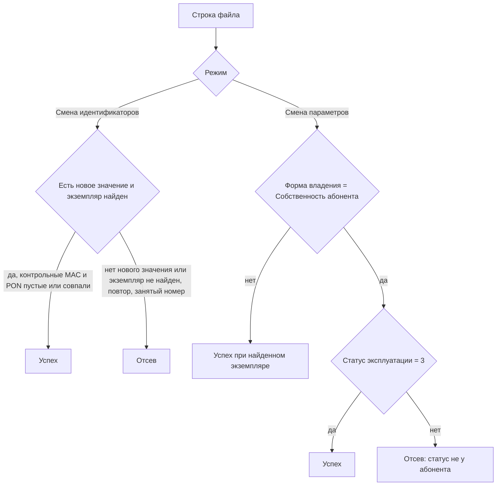

# Сценарии испытания смены серийных номеров и параметров

Текст приведён к форме «Загрузка и проверка смены серийных номеров». Отдельного вида складской операции «Изменение параметров оборудования» и проверок склада, ТУ, условия передачи и типа АО/СО в загрузке нет. Файл один и тот же для абонентского и сетевого оборудования.

## Комбинации успеха и отсева

Статус эксплуатации `3` («у абонента») проверяется только тогда, когда на форме в режиме «Смена параметров» выбрана форма владения «Собственность абонента». Для остальных форм владения, для пустой формы владения и для смены только состояния или тех. состояния статус не проверяется. Смена идентификаторов статус не проверяет.

| Режим | Новые SN, MAC, PON | Форма владения | Статус экземпляра | Результат |
|---|---|---|---|---|
| Смена идентификаторов | Заполнено хотя бы одно новое значение, оно свободно, в файле нет повторов | Не передаётся | Любой | Успех |
| Смена идентификаторов | Все новые поля пустые | Не передаётся | Любой | Отсев: Не задано ни одного нового значения |
| Смена идентификаторов | Серийный номер в системе не найден | Не передаётся | Нет экземпляра | Отсев: Оборудование не найдено |
| Смена идентификаторов | `SN_новый` уже есть у другого экземпляра | Не передаётся | Найден | Отсев: Новый серийный номер уже есть в системе |
| Смена идентификаторов | `MAC_новый` уже есть у другого экземпляра | Не передаётся | Найден | Отсев: Новый MAC уже есть в системе |
| Смена идентификаторов | Любые | Не передаётся | Найден, контрольный MAC не совпал | Отсев: Контрольный MAC не совпал |
| Смена идентификаторов | Любые | Не передаётся | Найден, контрольный PON не совпал | Отсев: Контрольный PON не совпал |
| Смена идентификаторов | Повтор `SN_текущий`, `SN_новый` или `MAC_новый` в файле | Не передаётся | Любой | Отсев: Повторяющийся SN_текущий / SN_новый / MAC_новый |
| Смена идентификаторов | Любые | Не передаётся | Два экземпляра с одним серийным номером | Отсев: Найдено больше одного экземпляра |
| Смена параметров | Не проверяются | Пусто, «Собственность компании» либо меняются только состояние и тех. состояние | Любой | Успех, если экземпляр найден и контрольные MAC и PON пустые или совпали |
| Смена параметров | Не проверяются | Собственность абонента | `3`, у абонента | Успех, если экземпляр найден и контрольные MAC и PON пустые или совпали |
| Смена параметров | Не проверяются | Собственность абонента | Не `3` | Отсев: Статус эксплуатации оборудования не соответствует значению «у абонента» |

## 4.2.2. Подготовительные мероприятия для сценариев с успешным результатом

На тестовых складах завести экземпляры из таблицы 1. Документ корректировки создаётся на том складе, где пользователю доступна загрузка оборудования в документ. Склад размещения экземпляра со складом документа загрузчик не сверяет.

Сформировать два файла CSV в кодировке Windows-1251, разделитель «;», первая строка — заголовок:

`SN_текущий;MAC_текущий;PON_текущий;SN_новый;MAC_новый;PON_новый`

Пустое новое поле означает, что этот атрибут не меняется. `SN_текущий` обязателен и является ключом поиска экземпляра. Заполненные `MAC_текущий` и `PON_текущий` — контрольные значения. Допустимы также xls и xlsx: перед разбором они преобразуются в CSV.

### Таблица 1. Успешный результат

| № | Экземпляр | Что записано в файле | Режим на форме | Файл |
|---|---|---|---|---|
| 1 | Уникальный серийный номер, MAC и PON. Новые серийный номер и MAC в системе свободны | Контрольные MAC и PON совпадают с экземпляром. Заполнены `SN_новый`, `MAC_новый`, `PON_новый` | Смена идентификаторов | Файл 1 |
| 2 | Другой экземпляр с уникальным серийным номером | Заполнен только `SN_новый`. `MAC_новый` и `PON_новый` пустые | Смена идентификаторов | Файл 1 |
| 3 | Экземпляр в любом статусе эксплуатации | Новые SN, MAC и PON пустые. Контрольные MAC и PON либо пустые, либо совпадают с экземпляром | Смена параметров. Форма владения «Собственность компании» либо пустая, заданы состояние и тех. состояние | Файл 2 |
| 4 | Экземпляр в статусе `exploit_status_id = 3`, «у абонента» | Новые SN, MAC и PON пустые. Контрольные MAC и PON либо пустые, либо совпадают с экземпляром | Смена параметров. Форма владения «Собственность абонента» | Файл 2 |

## 4.2.3. Подготовительные мероприятия для сценариев с неуспешным результатом

Файл 3 проверяется в режиме «Смена идентификаторов», файл 4 — в режиме «Смена параметров». Состав колонок тот же, что у файлов 1 и 2.

### Таблица 2. Неуспешный результат

| № | Условие | Текст в колонке «Результат проверки» | Файл |
|---|---|---|---|
| 1 | `SN_текущий` в системе отсутствует | Оборудование не найдено | Файл 3 |
| 2 | Экземпляр найден, `MAC_текущий` заполнен и не совпадает с MAC оборудования | Контрольный MAC не совпал | Файл 3 |
| 3 | Экземпляр найден, `PON_текущий` заполнен и не совпадает с PON оборудования | Контрольный PON не совпал | Файл 3 |
| 4 | Новые SN, MAC и PON пустые | Не задано ни одного нового значения | Файл 3 |
| 5 | Две строки с одним и тем же `SN_текущий` | Повторяющийся SN_текущий | Файл 3 |
| 6 | Две строки с одним и тем же `SN_новый`, и он отличается от текущего | Повторяющийся SN_новый | Файл 3 |
| 7 | `SN_новый` уже записан на другом экземпляре, который не отдаёт этот номер в этом же файле | Новый серийный номер уже есть в системе | Файл 3 |
| 8 | `MAC_новый` уже записан на другом экземпляре | Новый MAC уже есть в системе | Файл 3 |
| 9 | Два действующих экземпляра с одним серийным номером | Найдено больше одного экземпляра | Файл 3 |
| 10 | Режим «Смена параметров», форма владения «Собственность абонента», серийный номер найден, `exploit_status_id` не равен 3 | Статус эксплуатации оборудования не соответствует значению «у абонента» | Файл 4 |

## 4.3. Сценарии тестирования

### Сценарий 4.3.1. Доступ к загрузке смены серийных номеров

Цель: привилегия `StoreDeviceView.AddIdentifierChange` открывает на форме оборудования документа кнопку «Смена серийных номеров из файла».

Подготовка: войти в интерфейс склада.

#### Таблица 3

| № | Интерфейс | Действия | Результат |
|---|---|---|---|
| 1 | Склад → Справочники → Роли и привилегии | Для роли «Администрирование» добавить привилегию с кодом `StoreDeviceView.AddIdentifierChange`. Перезапустить приложение «Склад». | Привилегия назначена роли. |
| 2 | Документ склада, на котором доступна команда «Добавить из файла» | 1. Открыть табличную часть оборудования документа. 2. Убедиться, что рядом с «Добавить из файла» активна кнопка «Смена серийных номеров из файла». 3. Открыть её. 4. На форме «Загрузка и проверка смены серийных номеров» проверить два режима: «Смена идентификаторов» и «Смена параметров». 5. В режиме «Смена идентификаторов» списки формы владения, состояния и тех. состояния скрыты. 6. В режиме «Смена параметров» эти три списка видны и задаются один раз на все строки файла. 7. Скачать шаблон и сверить заголовок: `SN_текущий;MAC_текущий;PON_текущий;SN_новый;MAC_новый;PON_новый`. | Кнопка доступна только при привилегии `StoreDeviceView.AddIdentifierChange` и при том же условии видимости, что и «Добавить из файла». Отдельного пункта «Изменение параметров оборудования» в списке операций документа нет. Набор редактируемых атрибутов задаётся режимом формы загрузки, а не полями документа. |

### Сценарий 4.3.2. Загрузка файла, отсев и запись в документ

Цель: проверка всего файла, отсев ошибочных строк, запись успешных строк в документ и обновление оборудования при закрытии.

Подготовка: выполнить п. 4.2.2 и 4.2.3. Процедура закрытия документа вызывает `close_identifier_change_doc`.

#### Таблица 4

| № | Интерфейс | Действия | Результат |
|---|---|---|---|
| 1 | Документ тестового склада 1, форма «Загрузка и проверка смены серийных номеров» | 1. Оставить режим «Смена идентификаторов». 2. Загрузить файл 3. 3. Нажать «Проверить», если проверка не стартовала при чтении файла. 4. Сверить колонку «Результат проверки» со строками 1–9 таблицы 2. 5. У ошибочных строк галочка снята, в резюме они входят в «Отсев». 6. Загрузить файл 1 и проверить его. 7. У строк со статусом «Успешно» галочка проставлена. 8. Нажать «Добавить». | В документ попадают только отмеченные строки со статусом 1. Оборудование привязывается к документу. Успешный набор записывается в XML документа. Строки файла 3 в документ не попадают. |
| 2 | Документ тестового склада 2, та же форма | 1. Выбрать «Смена параметров» и форму владения «Собственность абонента». 2. Загрузить файл 4 и проверить его. 3. Для строки 10 таблицы 2 убедиться в тексте «Статус эксплуатации оборудования не соответствует значению «у абонента»» и в отсутствии галочки. 4. Не меняя форму владения, загрузить экземпляр из строки 4 таблицы 1 и проверить его. 5. Переключить форму владения на «Собственность компании» и отдельно загрузить экземпляр из строки 3 таблицы 1. Форма владения на форме одна на всю загрузку. 6. Успешные строки отметить и нажать «Добавить». | В XML передаётся признак смены параметров и выбранная форма владения. Новые SN, MAC и PON не требуются. Статус 3 требуется только при форме владения «Собственность абонента». |
| 3 | Закрытие обоих документов | Закрыть документ склада 1 и документ склада 2. | По экземплярам файла 1 записаны непустые новые SN, MAC и PON. Пустое новое поле значение на оборудовании не затирает. По экземплярам файла 2 записаны форма владения, состояние и тех. состояние, выбранные на форме. Серийный номер, MAC и PON этих экземпляров остаются прежними. |

Переключение режима снимает все галочки. После переключения файл нужно проверить снова: успешные строки отметятся заново.

### Сценарий 4.3.3. Следы операции в документе и на оборудовании

Цель: убедиться, что загрузка и закрытие оставляют штатный след документа и экземпляра. Отдельной вкладки истории корректировки эта доработка не создаёт.

| № | Интерфейс | Действия | Результат |
|---|---|---|---|
| 1 | Табличная часть закрытого документа | Открыть документ склада 1 и документ склада 2. | В составе документа оборудование из успешного файла этого склада. Экземпляры из файлов 3 и 4 отсутствуют. |
| 2 | Экземпляр оборудования | Открыть экземпляры из файлов 1 и 2. | Значения совпадают с результатом шага 3 сценария 4.3.2. |
| 3 | Штатные «Список документов», «История» и «Аудит» | Отобрать документы и оборудование по дате испытания и логину исполнителя. | В списках есть оба тестовых документа и экземпляры, изменённые при закрытии. Состав записей определяется существующим аудитом `storedoc_dev_link_add` и `store_device_update_lite`. |
